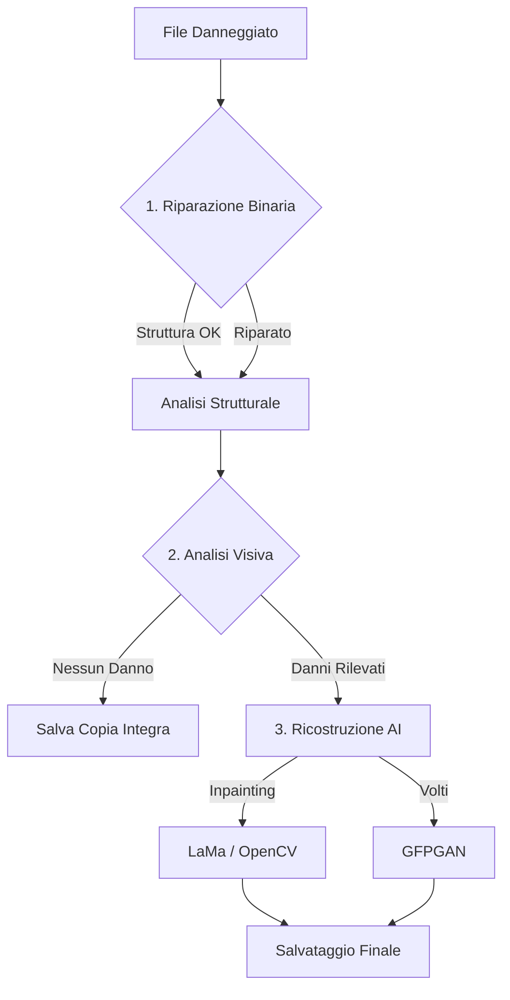

# RiparaFoto 

Software open-source per il ripristino avanzato e la ricostruzione intelligente di fotografie danneggiate, corrotte o incomplete.

Combina l'analisi strutturale a basso livello del binario JPEG/PNG con modelli di intelligenza artificiale per l'inpainting globale (**LaMa**) e il restauro dei volti (**GFPGAN**).

---

## Caratteristiche principali

- 🛠️ **Riparazione del binario JPEG e PNG**: Correzione di header troncati, mancanti (SOI/EOI) o danneggiati, allineamento MCU e riparazione dell'entropia di scansione.
- 🧠 **Inpainting Globale LaMa (Large Mask)**: Ricostruzione in single-pass a contesto intero delle aree mancanti o corrotte, senza cuciture e senza artefatti di blocco.
- 👤 **Miglioramento Volti con GFPGAN**: Ripristino dei dettagli del viso tramite warping affine e landmark nativi (applicato selettivamente ai volti danneggiati).
- 🔍 **Rilevamento Automatico dei Difetti**: Individuazione precisa di aree piatte, buchi grigi/neri tipici di decoder corrotti, glitch cromatici e righe duplicate, con zero falsi positivi su foto sane.
- 🎨 **Interfaccia Grafica (GUI Tkinter)**: Facile da usare per elaborare singole immagini o intere cartelle con barra di avanzamento e anteprima esiti.
- ⚡ **Accelerazione GPU (NVIDIA CUDA)**: Riconoscimento ed esecuzione automatica su GPU NVIDIA compatibili o fallback su CPU / OpenCV.
- 💻 **Interfaccia CLI da Terminale**: Supporta elaborazioni batch, ricorsive e script automatizzati.

---

## Pipeline di elaborazione

Il programma elabora ogni immagine attraverso tre fasi sequenziali, dal livello più "fisico" (i byte) a quello più "visivo" (i pixel).



### 🔧 Fase 1: Riparazione del Binario (Struttura del File)

Prima di analizzare i pixel, il programma ripara il file come sequenza di byte.

- **Analisi dei Marcatori**: Riconosce e ripristina l'intestazione (SOI) e la fine (EOI) del JPEG.
- **Decodifica Huffman**: Scansiona i blocchi MCU. Se trova un errore di decodifica (es. un bit corrotto), taglia i dati in quel punto esatto per evitare che il decoder generi "rumore" a caso.
- **Recupero da Troncamento**: Se il file è incompleto, reinserisce i blocchi di chiusura per salvare tutta la parte sana dell'immagine.

### 🔍 Fase 2: Analisi Visiva (Ricerca dei Danni)

Una volta che il file è strutturalmente valido, il programma cerca i danni nei pixel.

- **Rilevamento della Varianza**: Cerca aree perfettamente piatte (varianza vicina a zero) che hanno i colori tipici degli errori di compressione (Grigio 128, Nero puro, o "glitch" Neon).
- **Creazione della Maschera**: Genera una mappa (maschera) in cui i pixel bianchi indicano esattamente all'AI dove sono i buchi da riempire, preservando il resto della foto.

### 🤖 Fase 3: Ricostruzione AI (Inpainting & Volti)

La maschera viene passata a due modelli di Deep Learning per riempire le zone mancanti in modo intelligente.

- **LaMa**: Analizza il contesto circostante (muri, cielo, strada) e riempie i buchi in modo coerente, senza sfocare.
- **GFPGAN**: Se la maschera tocca un volto umano, un modello dedicato ripristina occhi, naso e bocca in modo realistico.
- **Blending (Fusione)**: L'immagine originale e quella ricostruita vengono fuse con una sfumatura per nascondere i bordi della riparazione.

---

## Requisiti di sistema

- **Python**: 3.10 o superiore
- **OS**: Windows, Linux o macOS
- **GPU consigliata**: NVIDIA compatibile con CUDA (almeno 4-6 GB VRAM) per velocizzare i modelli AI (può funzionare anche su CPU o con fallback OpenCV).

---

## Installazione

1. **Clona il repository**:
   ```bash
   git clone https://github.com/iosonobob/riparafoto.git
   cd riparafoto
   ```

2. **Crea un ambiente virtuale (consigliato)**:
   ```bash
   python -m venv venv
   # Su Windows:
   venv\Scripts\activate
   # Su Linux / macOS:
   source venv/bin/activate
   ```

3. **Installa PyTorch con supporto CUDA** (se hai una GPU NVIDIA):
   Consulta [pytorch.org](https://pytorch.org/get-started/locally/) per la stringa esatta. Ad esempio per CUDA 12.4:
   ```bash
   pip install torch torchvision --index-url https://download.pytorch.org/whl/cu124
   ```

4. **Installa le dipendenze**:
   ```bash
   pip install -r requirements.txt
   ```

---

## Utilizzo

### Modalità Grafica (GUI)

Avvia la finestra interattiva:
```bash
python riparafoto.py --gui
```
Dalla schermata potrai aggiungere foto, scegliere la cartella dove salvare i risultati e avviare la riparazione.

### Modalità Linea di Comando (CLI)

- **Riparare una singola foto**:
  ```bash
  python riparafoto.py "percorso/foto_danneggiata.jpg" -o "riparate"
  ```

- **Riparare un'intera cartella (anche sottocartelle)**:
  ```bash
  python riparafoto.py "C:\FotoDaRiparare" -o "C:\FotoRiparate" -r
  ```

- **Forzare l'analisi visiva su immagini apparentemente integre**:
  ```bash
  python riparafoto.py "foto.jpg" --forza
  ```

---

## Licenza

Questo progetto è rilasciato sotto licenza [MIT](LICENSE).
